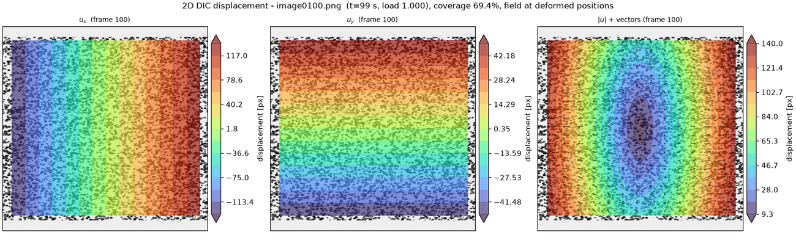
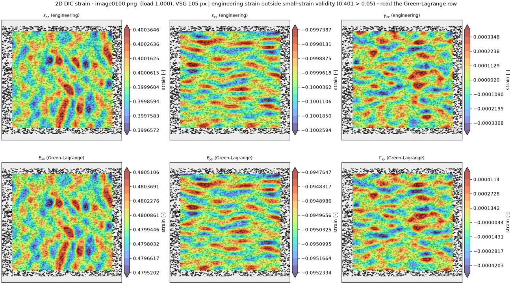
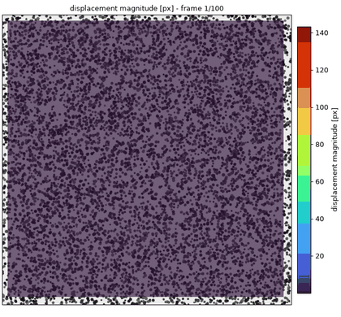
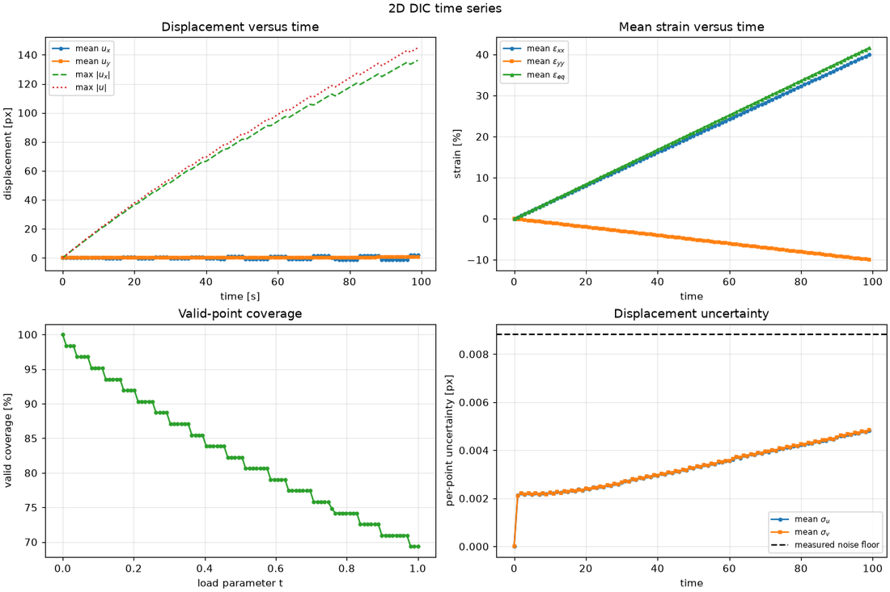
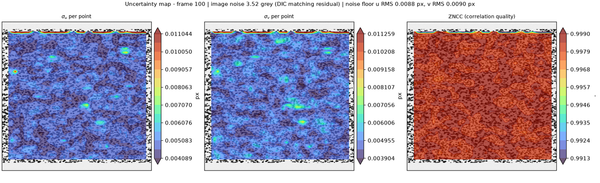

# DIC — 2D Digital Image Correlation with built-in validation

A research-grade, CPU-only command-line tool that measures **full-field 2D displacement and strain**
from a sequence of speckle-pattern images, and that **quantifies its own accuracy** so an engineer
can trust the numbers.

* Local subset-based DIC: **ZNSSD** criterion, **affine** shape functions, **inverse-compositional
  Gauss–Newton** solver, prefiltered **B-spline** sub-pixel interpolation with exact derivatives.
* Handles **large deformation, rotation and translation** (hierarchical multi-scale initial guess
  with a rotation search, plus an optional incremental reference-updating mode).
* **Automatic ROI detection** (excludes non-speckled background) with a user-mask override.
* Reports **per-point uncertainty** and a measured **zero-motion noise floor**, and ships a
  **synthetic validation suite** with known ground truth.
* Produces, **for every input image**, a displacement overlay and a strain figure, plus
  machine-readable fields, a summary report and extra engineering visualizations.

The state-of-the-art survey that drove the design is in [`docs/RESEARCH.md`](docs/RESEARCH.md);
the mathematics is in [`docs/ALGORITHM.md`](docs/ALGORITHM.md); every design choice is justified in
[`DECISIONS.md`](DECISIONS.md); the measured accuracy is in
[`validation_report.md`](validation_report.md).

---

## Gallery

Produced by `python -m dic Data01 runs/Data01_full` on the provided dataset (last frame, 40 %
engineering strain). The field is drawn on the **current frame** at the material positions
`X + u`, so the specimen visibly deforms and the field follows the material
(`--overlay reference` gives the fixed-reference view instead).

**Displacement** — `u_x`, `u_y`, `|u|` with vectors:



**Strain** — engineering (top row) next to Green–Lagrange (bottom row), so the small-strain
caveat is visible rather than buried in a log message:



**Animation** (12-frame preview of the 100-frame run):



**Accuracy and quality** — mean/max displacement and strain versus time, and the per-point
uncertainty map:




---

## Install

Requires **Python ≥ 3.10**.

```bash
python -m venv .venv && source .venv/bin/activate
pip install -e .
```

Optional extras:

```bash
pip install -e ".[fast]"   # tqdm progress bars
pip install -e ".[dev]"    # pytest + ruff
```

Dependencies: numpy, scipy, pillow, matplotlib (all mainstream, permissively licensed — see
`DECISIONS.md` §8). No GPU, no JIT, no compiled extension.

## Five-minute quick start

```bash
# 1. run on the provided test dataset (read-only) and write results elsewhere
python -m dic Data01 /tmp/dic_data01

# 2. look at the summary and the accuracy statement
less /tmp/dic_data01/summary_report.md

# 3. look at one frame
xdg-open /tmp/dic_data01/figures/displacement/disp_0100.png
xdg-open /tmp/dic_data01/figures/strain/strain_0100.png
```

That command produces, in `/tmp/dic_data01/`:

```
params.json                     full settings, package versions, input names + SHA-256
summary_report.md               what ran, coverage/quality per frame, accuracy statement
run.log                         the log
mask/mask_used.png|.npz         the ROI actually used
grid.csv                        correlation-grid coordinates
fields/frame_0001.npz …         per-frame ux, uy, valid, zncc, sigma_u/v, all strain fields
displacement_timeseries.csv     per-frame mean/max displacement, coverage, quality
strain_timeseries.csv           per-frame mean/max strain
figures/displacement/*.png      one displacement overlay per input image
figures/strain/*.png            one strain figure per input image
extras/curves.png               mean/max displacement and strain vs time
extras/profiles.png             line profiles through the last frame
extras/uncertainty.png          per-point uncertainty and ZNCC maps
animations/displacement.gif     growing displacement field
animations/exx.gif              growing strain field
```

### Run the demo (synthetic data with known ground truth)

```bash
bash examples/run_demo.sh /tmp/dic_demo
```

This generates five synthetic sequences covering the modes `Data01/` does **not** exercise, then
analyses each one and runs the validation suite. **What to expect:** each preset is a 12-frame
640×640 sequence; every run takes a few seconds and writes a full output tree (per-frame figures,
fields, summary report). The presets are

| Preset | What it exercises | Expected result |
|---|---|---|
| `rotation` | rigid rotation 0→30° **and** translation 0→(25,−15) px, at 1°/frame | coverage falls as the corners leave the frame; engineering strain ≈ −0.13, Green–Lagrange ≈ 0 |
| `masked` | a speckled patch on a flat background | the auto-mask detects the patch (≈40 % of the frame) and correlates only there |
| `illumination` | translation with gain 1→1.25 and a linear illumination ramp | ZNSSD absorbs the change; u RMS stays < 0.05 px |
| `noisy` | 15 % stretch at σ = 5.1 grey levels (2 % of range) | higher noise floor, still accurate |
| `nonuniform` | smooth sinusoidal + linear field | strain gradients recovered; Green–Lagrange differs from engineering |

To generate datasets without running the analysis:

```bash
python examples/generate_demo.py --output /tmp/demo --preset masked --frames 20
python -m dic /tmp/demo/masked /tmp/demo_out --scale 0.05 --unit mm
```

### Measure the accuracy-versus-cost trade-offs

```bash
python examples/parameter_sweep.py --subsets 21 31 41 61 --windows 3 5 9
```

prints a measured table of displacement/strain noise floors versus subset and strain window — the
evidence behind the guidance in `summary_report.md`. At σ = 2 grey levels and step 16 px, for
example: the displacement noise floor falls from 0.0115 px (subset 21) to 0.0028 px (subset 61);
at subset 31 the strain noise floor falls from 8×10⁻⁵ (3-point window, VSG 63 px) to
6×10⁻⁶ (9-point window, VSG 159 px).

### Run the validation suite

```bash
python -m dic --validate /tmp/dic_validation                 # synthetic cases only
python -m dic Data01 /tmp/dic_validation --validate          # + the provided dataset
less /tmp/dic_validation/validation_report.md
```

---

## CLI reference

```
python -m dic IMAGES OUTPUT [options]
python -m dic --validate OUTPUT [options]
```

`IMAGES` is a directory of speckle images (read-only; never modified). `OUTPUT` is created and
populated. Run `python -m dic --help` for the authoritative list; the table below summarises it.

### Acquisition

| Option | Default | Unit | Meaning |
|---|---|---|---|
| `--dt` | `1.0` | s | Seconds between frames; `<= 0` uses the frame index. |
| `--scale` | `1.0` | unit/px | Physical length of one pixel (e.g. `0.05` for mm/px). |
| `--unit` | `px` | — | Label for `--scale` (`mm`, `um`, `in`, …). |
| `--max-images` | all | — | Process only the first N images (debugging). |

### Correlation

| Option | Default | Unit | Meaning |
|---|---|---|---|
| `--subset` | `41` | px | Odd subset side; should contain ≥ 3 speckles of 3–5 px. |
| `--step` | `16` | px | Grid spacing between correlation points. |
| `--interp-order` | `3` | — | B-spline order for the deformed image (3 = bicubic, 5 = biquintic). |
| `--prefilter` | `1.0` | px | Gaussian pre-filter σ applied to both images; `0` disables. |
| `--reference` | `first` | — | `first`: always the original reference (no accumulation). `incremental`: update the reference (accumulates error). |
| `--update-interval` | `1` | frames | Incremental mode: promote the reference every N frames. |
| `--init` | `auto` | — | Initial guess: `auto`, `temporal`, `coarse`. |
| `--search-radius` | `12` | px | Integer search radius for large inter-frame motion. |
| `--max-iter` | `30` | — | Maximum IC-GN iterations per point. |
| `--conv-tol` | `1e-4` | px, – | IC-GN convergence tolerance. |
| `--min-zncc` | `0.5` | – | Minimum ZNCC for a point to be valid. |
| `--min-coverage` | `0.30` | – | Fail if the valid-point fraction drops below this. |

### Region of interest

| Option | Default | Unit | Meaning |
|---|---|---|---|
| `--mask` | — | path | User mask (255 = valid) or a directory of per-frame masks. |
| `--mask-mode` | `auto` | — | `auto`, `user`, `none`. |
| `--mask-index` | `0` | — | Which frame's mask to use when `--mask` is a directory. |
| `--mask-window` | `21` | px | Local-variance window for automatic masking. |
| `--mask-threshold` | `0.25` | – | Auto-mask threshold as a fraction of the texture range. |

### Strain, uncertainty, output, runtime

| Option | Default | Unit | Meaning |
|---|---|---|---|
| `--strain-window` | `5` | points | Plane-fit window; sets the virtual strain gauge length. |
| `--noise-sigma` | `0` | grey | Override the estimated image noise (`0` = estimate). |
| `--no-noise-floor` | off | — | Skip the empirical zero-motion noise floor. |
| `--no-figures` / `--no-extras` | off | — | Skip per-frame figures / the extra visualizations. |
| `--dpi` | `110` | dpi | Figure resolution. |
| `--animation-format` | `gif` | — | `gif` (no dependency) or `mp4` (needs ffmpeg). |
| `--overlay` | `deformed` | — | Draw the field on the current image at the material positions `X+u` (`deformed`, the specimen visibly deforms) or on the undeformed reference image (`reference`). |
| `--csv` | off | — | Also write the long-form per-point CSV. |
| `--jobs` | `1` | — | Worker processes for figure rendering. |
| `--seed` | `0` | — | Master random seed. |
| `--log-level` | `INFO` | — | `DEBUG`/`INFO`/`WARNING`/`ERROR`. |
| `--log-file` | `<output>/run.log` | path | Log file. |
| `--quiet` | off | — | Do not print progress. |
| `--validate` | off | — | Run the validation suite. |
| `--validate-quick` | off | — | Fast configuration for the validation suite. |

### Exit codes

| Code | Meaning |
|---|---|
| 0 | success |
| 1 | unexpected error |
| 2 | command-line usage error |
| 3 | input problem (missing directory, unreadable/inconsistent images, < 2 frames) |
| 4 | coverage collapsed below `--min-coverage` |
| 5 | one or more validation cases failed |

---

## Coordinate, unit and sign conventions

* Images are indexed `[row = y, col = x]`; **x points right, y points down** (image convention).
* **Figures**: by default the field is drawn on the **current frame's image** at the material
  positions `X + u`, so the specimen visibly deforms from frame to frame and the field follows the
  material (`--overlay deformed`). Use `--overlay reference` to draw every field on the
  undeformed reference image at the reference positions instead.
* The **first image in natural sort order** is the undeformed reference. Images are sorted
  naturally (`image2` before `image10`); gaps in the numbering produce a warning, not a failure.
* **Displacement** is reported **relative to the undeformed reference**, in pixels, or in
  `--unit` if `--scale` is given. `u_x` is horizontal, `u_y` is vertical (positive = downwards in
  the image). Incremental (frame-to-frame) fields are available through
  `--reference incremental`.
* **Strain** is dimensionless and uses the image frame:
  `exx = ∂u_x/∂x`, `eyy = ∂u_y/∂y`, `gamma_xy = ∂u_x/∂y + ∂u_y/∂x`, `exy = gamma_xy/2`.
  Positive `exx`/`eyy` means elongation along x/y.
* **Rotation** is reported as a small-angle value (`omega`, rad) and as a finite angle from the
  polar decomposition (`theta_deg`, degrees).
* **Equivalent strain** (`eps_eq`) is a von Mises measure assuming plane-strain
  incompressibility, `eps_zz = −(eps_xx + eps_yy)`.
* **Colour images** are converted to grayscale with the Rec. 601 luma weights
  (0.299 R + 0.587 G + 0.114 B); the alpha channel is dropped. Grey levels keep their native
  scale, so reported noise is in grey levels.
* **Invalid points are `NaN`** everywhere — never interpolated, never fabricated. The valid-point
  fraction is reported per frame.

### ⚠️ Engineering strain versus large strain

The engineering (small-strain) definition is only valid for small strain: for a pure stretch `λ`
the engineering strain is `λ − 1`, but the true (logarithmic) strain is `ln λ`; for a pure
rotation of angle θ the engineering tensor is `(cos θ − 1)·I ≠ 0` while the true strain is zero.
The tool therefore computes **both** the engineering components (`exx`, `eyy`, `gamma_xy`) and the
**Green–Lagrange** components (`Exx`, `Eyy`, `Exy`), plots them side by side, and **warns** when
`max|engineering strain|` exceeds 0.05. At large deformation, read the Green–Lagrange row.
On `Data01/`, which reaches 40 % engineering strain, the Green–Lagrange `Exx` at the last frame is
0.48 while the engineering `exx` is 0.40 — a 20 % difference.

---

## Reading the error numbers

Every run writes an accuracy statement into `summary_report.md`:

* **Noise floor** — the apparent displacement/strain produced on data with zero true motion,
  measured with *your* speckle, subset, grid and noise. Anything smaller than ~2–3× the noise
  floor is not resolvable.
* **Per-point `sigma_u`, `sigma_v`** — a model-based estimate `σ_r·√(H⁻¹)` from the matching
  residual and the correlation Hessian, written into every `fields/frame_XXXX.npz` and mapped in
  `extras/uncertainty.png`. It varies across the field with local contrast.
* **Coverage** — the valid-point fraction per frame; a shrinking coverage late in a large-strain
  test is correct behaviour (the material leaves the field of view), not a failure.

`validation_report.md` adds the **independent** claim: measured errors against analytic ground
truth, on both the provided dataset and the synthetic suite.

---

## Measured accuracy

The full numbers, produced by the code itself, are in
[`validation_report.md`](validation_report.md). Summary (default settings):

**Provided dataset `Data01/` (100 frames, 1024², uniform stretch to 40 % engineering strain):**

| Quantity | Measured |
|---|---|
| Displacement RMS error (u / v) | **0.0066 / 0.0054 px** |
| Displacement max error | 0.020 / 0.017 px |
| Strain `exx` RMS error | **1.1×10⁻⁴** (0.011 %) |
| Strain `gamma_xy` RMS error | 1.3×10⁻⁴ |
| Coverage of comparable points | 93.8 % |
| Throughput | **1.8 s/frame** (3 844 points) |

**Synthetic suite (11 cases, all pass):** zero-motion noise floor 0.0034 px; sub-pixel translation
bias 0.0006 px; multi-pixel translation 0.014 px; 30° rotation 0.012–0.017 px (both single-step
and incremental); 20 % stretch 0.016 px with strain error 2.6×10⁻⁴; affine shear 0.012 px;
non-uniform field 0.035 px; linear illumination change 0.027 px; auto-masking with an empty
background (ROI 40 %, 0.011 px); high noise (2 % of range) 0.014 px. All displacement RMS errors
are well inside the published 0.01–0.05 px band and inside the targets fixed in `PLAN.md`.

## Repository layout

```
README.md               this file
pyproject.toml          packaging + pinned minimum dependencies
PLAN.md                 milestone plan and accuracy targets (Phase 1)
DECISIONS.md            every nontrivial design choice and its rationale
validation_report.md    measured accuracy against ground truth (written by `--validate`)
docs/RESEARCH.md        state-of-the-art survey with verified citations
docs/ALGORITHM.md       the mathematics of the implementation
src/dic/                the package (io, mask, correlation, strain, uncertainty,
                        pipeline, outputs, report, visualization, validation, cli, synth)
tests/                  pytest unit + integration suite
examples/               demo dataset generator and the one-command demo script
Data01/                 the provided test dataset (read-only)
runs/Data01_full/       a complete example run on Data01 (figures, fields, reports)
```

## Limitations (read this)

2D DIC measures the in-plane motion of a **planar** surface imaged by **one** camera. That
assumption is not enforced by the software and is the largest source of error in practice:

1. **Out-of-plane motion.** A through-thickness displacement `w` changes the apparent
   magnification by ≈ `w/Z` (Z = camera–specimen distance): 1 mm at 1 m ≈ 0.1 % spurious strain.
   Use stereo-DIC if the specimen moves out of plane.
2. **Lens distortion and a tilted camera** produce a spatially varying bias that this
   calibration-free pipeline cannot remove.
3. **Non-planar specimens** violate the pinhole assumption.
4. **Spatial resolution.** Strain is averaged over the virtual strain gauge
   `L_VSG = (window−1)·step + subset`; narrower strain peaks are attenuated. Reducing the window
   halves the gauge length but roughly doubles the strain noise.
5. **Illumination.** ZNSSD tolerates a global offset and gain, but not strong vignetting, shadows
   or specular hotspots.
6. **Speckle quality.** Speckles should be ~3–5 px and cover ~50 %. Poor speckle raises the noise
   floor — which the tool measures, so you can see it.
7. **Pattern-induced bias** affects very regular or very smooth patterns; the synthetic
   validation quantifies it for speckle-like patterns.
8. **The displacement field is a subset-averaged affine fit** — a low-pass version of the truth.

---

## Library use

Everything the CLI does is available as a library:

```python
from dic import RunConfig
from dic.pipeline import run_pipeline
from dic.outputs import write_all
from dic.report import write_summary

cfg = RunConfig()
cfg.correlation.subset_size = 41
cfg.strain.window = 5

result = run_pipeline("Data01", cfg)
print(result.frames[-1].strain["Exx"].mean())   # mean Green-Lagrange strain, last frame
write_all(result, "out")
write_summary(result, "out")
```

`RunResult` exposes the grid (`xs`, `ys`, `nx`, `ny`, `dx`, `dy`), the mask, the per-frame fields
(`ux`, `uy`, `valid`, `zncc`, `sigma_u`, `sigma_v`, `strain`), the uncertainty report and timings.

---

## Development

```bash
pip install -e ".[dev]"
pytest -q          # unit + integration tests, a few minutes
ruff check src tests
```

The test suite unit-tests every numerical component against an analytic case (interpolation and
its exact derivative, the affine warp, the correlation step on a synthetic patch with a known
shift, the strain operator on analytic fields, mask handling, natural sorting) plus an end-to-end
smoke test and reproducibility check.

## License

MIT (this implementation). The third-party dependencies keep their own licenses (see
`DECISIONS.md` §8). No code was copied from Ncorr, DICe, OpenCorr or py2DIC.
